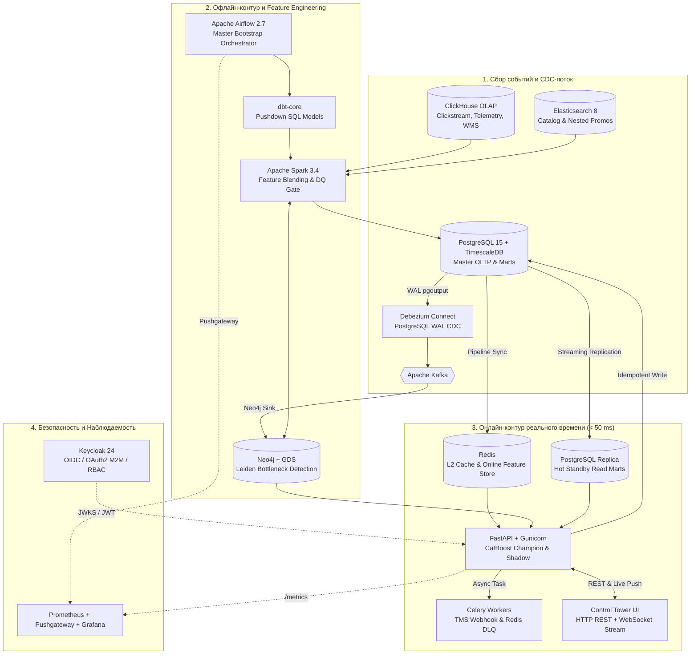

# Real-Time Commerce & Logistics Control Tower


> **Система раннего прогнозирования оттока и проактивного удержания клиентов на стыке UX-аналитики и логистики.**

Проект объединяет **аналитический контур** (ClickHouse → Apache Spark → Neo4j GDS → TimescaleDB → Redis Online Feature Store) и **оперативный контур реального времени** (Debezium CDC → Kafka → FastAPI + CatBoost → Celery → WebSocket Control Tower) в единый воспроизводимый стенд, разворачиваемый одной командой.

---

# Real-Time Commerce & Logistics Control Tower


> **Платформа предиктивной аналитики оттока и управления сбоями логистики в реальном времени для крупного e-commerce маркетплейса.**

---

## Контекст задачи

Для любого маркетплейса и сервиса экспресс-доставки удержание действующих покупателей обходится в разы дешевле привлечения новых. Но действующие клиенты по разным причинам могут уходить к конкурентам. При этом клиент редко уходит из-за одной случайной мелочи — обычно к оттоку приводит накопление негативного опыта: сначала пользователь сталкивается с техническими неполадками цифровой инфраструктуры, а затем его заказ застревает на перегруженном сортировочном хабе.

Главная проблема классических систем в том, что **данные о поведении покупателя и данные о доставке никак не связаны между собой**:
* **Отдел аналитики** видит, что у клиента вчера зависал сайт и сыпались ошибки при поиске, но не знает, что его текущий заказ прямо сейчас застрял на складе.
* **Служба логистики** видит задержку посылки на сортировочном хабе на 40 минут, но считает её рядовой и не знает, что этот же клиент только что еле оформил заказ с третьей попытки.

В итоге ни одна из систем не понимает, что покупатель уже на грани отказа. Поддержка подключается слишком поздно — когда человек сам пишет в чат, отменяет заказ или уходит к конкуренту.

### Главные цели и задачи платформы
1. **Связать накопленную аналитику с текущими событиями:** связать исторические поведенческие признаки пользователя с текущим состоянием его заказа на логистической магистрали.
2. **Предсказывать риск оттока «в моменте»:** за миллисекунды собирать 34 признака из разных источников и оценивать вероятность ухода клиента с помощью ML-модели **CatBoost**.
3. **Автоматически спасать проблемные заказы:** без участия человека выдавать персональный извинительный промокод и давать диспетчерам инструмент для мгновенного перенаправления посылок в обход заторов.
4. **Обеспечить продакшн-надёжность:** гарантировать работу сервиса под высокой нагрузкой с защитой от сбоев отдельных баз данных, идемпотентностью операций, ролевой безопасностью и сквозным мониторингом.


## Бизнес-ценность

1. **Упреждающее удержание клиентов:** система вовремя замечает, что покупатель раздражён сбоями в приложении (частые клики от зависаний, постоянные возвраты из карточки товара в каталог, ошибки API, сбросы фильтров поиска) и при этом его заказ задерживается в доставке. Не дожидаясь отмены заказа или жалобы, платформа автоматически начисляет клиенту персональный извинительный промокод.
2. **Защита юнит-экономики:** сумма компенсации рассчитывается динамически — с учётом пожизненной ценности клиента (LTV), чистой маржи конкретного заказа и срочности доставки (например, для экспресс-доставки продуктов с жёстким SLA до 30 минут). Это позволяет удерживать покупателей без убытка для бизнеса.
3. **Поиск узких мест в логистике:** графовый движок на базе **Neo4j Graph Data Science** находит перегруженные сортировочные хабы и кросс-доки, автоматически снижает их доступную пропускную способность и передаёт эти ограничения в сервис маршрутизации, чтобы новые заказы не попадали в затор.
4. **Единый ситуационный центр (Control Tower UI):** диспетчеры логистики и операторы колл-центра видят актуальную картину сбоев и заблокированных хабов по **HTTP** и **WebSocket** в реальном времени. Они могут в один клик перенаправить проблемный заказ в обход перегруженного узла командой в систему управления транспортом (TMS).

---

## Архитектура системы

Платформа спроектирована по гибридной архитектуре **Lambda / Kappa** со строгим разделением аналитических (OLAP) и транзакционных (OLTP) потоков:



## Детальная документация контуров

* **[Оперативный контур реального времени (`apps/backend-online-contour/README.md`)](./apps/backend-online-contour/README.md)** — описание REST API и ролевой модели доступа через **Keycloak**, разделение нагрузки на чтение и запись в **PostgreSQL** (`asyncpg`), прогрев и фоновое сравнение двух моделей **CatBoost**, двухуровневое кэширование (в памяти и в **Redis**), защита от сбоев баз данных, гарантированная отправка задач через **Celery** с очередью потерянных сообщений и конфигурация для **Kubernetes**.
* **[Аналитический контур (`data_pipelines/README.md`)](./data_pipelines/README.md)** — устройство хранилища витрин и признаков (**TimescaleDB**), схема запуска цепочек задач в **Apache Airflow**, предварительная фильтрация данных через **dbt-core**, поиск узких мест в логистике алгоритмом Лейдена в **Neo4j Graph Data Science**, многоступенчатые проверки качества данных в **Apache Spark** и загрузка готовых признаков в **Redis**.

---
## Ключевые инженерные решения и паттерны

### 1. Потоковое и пакетное обновление данных (`CDC`, `data_pipelines`)
* **Сбор данных и предварительная фильтрация:** потоки кликстрима, веб-метрик, поиска и складских сканирований принимаются в **ClickHouse**, а модели **dbt-core** нарезают данные по датам до загрузки в память.
* **Графовые вычисления и защита памяти:** аналитический контур догружает события сканирования в **Neo4j**, разворачивает временную проекцию графа в оперативной памяти (**Neo4j Graph Data Science**), находит заторы на хабах и пересчитывает время и задержки доставки с учётом загруженности узлов и графиков работы, после чего принудительно удаляет проекцию из RAM.
* **Расчёт признаков и контроль качества в Apache Spark:** параллельно считаются поведенческие и логистические метрики, применяется обогащение из **Elasticsearch** (со скидками через Painless-скрипты) и 5 барьеров качества данных (проверка на пустоту, дубли, хронологию ТСД, целостность каталога и выбросы > 4 сигм).
* **CDC в реальном времени:** новые заказы из **PostgreSQL** через журнал транзакций (WAL) и **Debezium** мгновенно попадают в **Kafka**, откуда **Neo4j Streams** в реальном времени обновляет узлы и связи в графе без опроса базы.
* **Витрины и прогрев онлайн-слоя:** признаки сливаются в таблицах **PostgreSQL + TimescaleDB** со сжатием, формируют витрины инцидентов, компенсаций и лимитов хабов, а затем пакетно (`Redis Pipeline`) выгружаются в **Redis** для мгновенного чтения из API.
* **Оркестрация без ручных действий:** главный даг в **Apache Airflow** (`master_bootstrap_pipeline`) снимает дочерние даги с паузы, прогоняет все даги в определенном порядке и возвращает их на паузу по завершении выполнения.

### 2. Онлайн-инференс и работа с данными (`backend-online-contour`)
* **Сборка вектора из 34 признаков за миллисекунды:** сервис параллельно забирает поведенческие метрики пользователя из **Redis**, актуальные графовые признаки маршрута заказа из **Neo4j**, добавляет признаки, вычисляемые на основе существующих из разных СУБД, и передаёт вектор в **CatBoost**.
* **Прогрев и теневое сравнение моделей:** основная модель прогревается в памяти до открытия приёма трафика, расчёт вынесен в отдельный поток без блокировки сети, а вторая модель-кандидат параллельно отрабатывает в фоне и пишет расхождение прогнозов в **Prometheus**.
* **Разделение чтения и записи + двухуровневый кэш:** чтение аналитики идёт на реплику **PostgreSQL** и двухуровневый кэш (в оперативной памяти воркера с HMAC-подписью ключей и в **Redis**), а запись промокодов и статусов инцидентов — строго на мастер-базу с защитой от дублей.

### 3. Отказоустойчивость и защита под нагрузкой
* **Предохранители и плавная деградация:** для **Redis**, **Neo4j** и **PostgreSQL** настроены независимые предохранители — при сбое любой базы сервис изолирует её, переключает скоринг на резервную формулу и продолжает отвечать без 500-х ошибок.
* **Отсечение лишней нагрузки:** при превышении лимита одновременных запросов сервис мгновенно отвечает `503 Retry-After`, защищая память от переполнения.
* **Идемпотентность на двух уровнях:** повторные `POST`-запросы с тем же заголовком `X-Idempotency-Key` в течение 24 часов возвращают сохранённый ответ из **Redis** (`SET NX`), а на уровне базы повторная вставка блокируется уникальным индексом.
* **Гарантированная доставка команд в логистику (Celery):** фоновые задачи перемаршрутизации выполняются с нарастающими паузами при сбоях, а после исчерпания попыток паркуются в специальную очередь ошибок и список в **Redis** для разбора.
* **Плавная остановка воркеров:** при перезапуске контейнера сервис сначала закрывает пробу готовности, дожидается завершения всех текущих запросов и только потом закрывает пулы соединений с базами.

### 4. Безопасность, реалтайм-интерфейс и наблюдаемость
* **Авторизация и ролевая модель (Keycloak):** проверка JWT-токенов по публичным ключам (JWKS) с автоматическим обновлением при смене ключей, межсервисная авторизация, разграничение прав по ролям и мгновенный отзыв токена при выходе через чёрный список в **Redis**.
* **Ситуационный центр в реальном времени:** веб-консоль диспетчера работает одновременно по REST API и **WebSocket**, каждые 3 секунды получая живой срез активных инцидентов и заблокированных хабов.
* **Сквозной мониторинг:** онлайн-метрики API, задержек моделей и состояний предохранителей собираются в **Prometheus** и выводятся в **Grafana**, а метрики пакетных запусков Airflow отправляются через **Pushgateway**.

---

## Основные возможности API и WebSocket (`/api/v1`)

| Метод | Эндпоинт | Назначение |
| :--- | :--- | :--- |
| `POST` | `/api/v1/auth/login` | Вход пользователя через Keycloak и получение токенов доступа. |
| `POST` | `/api/v1/auth/logout` | Выход из системы и мгновенный отзыв токена. |
| `POST` | `/api/v1/inference/churn-risk` | Оценка риска оттока клиента в реальном времени и автоматическая выдача промокода. |
| `GET` | `/api/v1/customer/{user_id}/compensations` | Просмотр истории начисленных клиенту компенсаций. |
| `GET` | `/api/v1/logistics/incidents/active` | Получение списка текущих сбоев и задержек на магистралях. |
| `POST` | `/api/v1/logistics/incidents/{id}/reroute` | Перенаправление проблемного заказа в обход сбойного узла. |
| `GET` | `/api/v1/topology/nodes/capacities` | Передача списка заблокированных и перегруженных хабов в сервис маршрутизации. |
| `GET` | `/api/v1/topology/nodes/{node_id}/health-passport` | Получение сводки о состоянии склада: текущая ёмкость, заторы и затронутый персонал. |
| `WS` | `/api/v1/ws/control-tower` | Живая трансляция сбоев, блокировок узлов и перемаршрутизаций в реальном времени. |

---

## Технологический стек

| Направление | Инструменты |
| :--- | :--- |
| **Бэкенд и инференс моделей** | Python 3.11, FastAPI, Gunicorn + Uvicorn, Pydantic v2, SQLAlchemy 2.0 (`asyncpg`), CatBoost, NumPy |
| **Обработка данных и оркестрация** | Apache Spark 3.4 (PySpark, Arrow Pandas UDF), Apache Airflow 2.7, dbt-core (`dbt-clickhouse`) |
| **Базы данных и хранилища** | PostgreSQL 15 + TimescaleDB (мастер и реплика), ClickHouse 23.8, Neo4j + Graph Data Science, Elasticsearch 8.12, Redis |
| **Потоковая передача и очереди** | Apache Kafka, Debezium Connect (PostgreSQL CDC + Neo4j Sink), Celery |
| **Безопасность и мониторинг** | Keycloak 24 (OIDC / OAuth2), Prometheus, Pushgateway, Grafana |
| **Фронтенд, инфраструктура и тестирование** | HTML5 / JavaScript (WebSocket UI), Docker Compose, Pytest, Locust |

---

## Быстрый старт (Запуск одной командой)

### 1. Развёртывание всего стенда
Из корневой директории репозитория выполните:
```bash
make up
```
*(Либо напрямую через `docker compose -f data_pipelines/deploy/docker-compose.yml -f apps/backend-online-contour/docker-compose.online.yml up -d --build`).*

После поднятия баз данных оркестратор `db-init-orchestrator` автоматически накатит DDL-миграции и загрузит синтетические датасеты, а `airflow-dag-bootstrap` снимет с паузы и выполнит сквозной граф **`master_bootstrap_pipeline`**, прогрев витрины TimescaleDB и онлайн-кэш Redis.

Отслеживать прогресс прогрева данных:
```bash
make logs-bootstrap
```

### 2. Доступные веб-интерфейсы

| Сервис | URL | Учётные данные / Примечание |
| :--- | :--- | :--- |
| **Control Tower UI (REST + WebSocket)** | `http://localhost:8000/ui` | Авто-вход (`dispatcher_ivanov` / `password123`) |
| **Apache Airflow UI** | `http://localhost:8089` | Оркестрация цепочек задач офлайн-контура |
| **Grafana Dashboards** | `http://localhost:3000` | `admin` / `admin` → *Online Contour* |
| **Prometheus (онлайн-контур)** | `http://localhost:9092` | Метрики FastAPI, CatBoost и предохранителей |
| **Prometheus (офлайн-контур)** | `http://localhost:9090` | Метрики пакетных запусков из Pushgateway |
| **Neo4j Browser** | `http://localhost:7474` | `neo4j` / `secure_graph_pass_99` |
| **Keycloak Admin Console** | `http://localhost:8090` | `admin` / `admin` (Realm: `retail-tech`) |

### 3. Остановка и очистка стенда
```bash
make down     # Остановить контейнеры с сохранением томов
make clean    # Полностью остановить и удалить тома данных
```

---

## Тестирование и нагрузочные бенчмарки

Для локального запуска тестов и генератора нагрузки предварительно установите зависимости онлайн-сервиса:
```bash
python3 -m venv apps/backend-online-contour/.venv
source apps/backend-online-contour/.venv/bin/activate
pip install -e "apps/backend-online-contour[dev]"
```

### Модульные и интеграционные тесты
Проверка 34-признакового вектора CatBoost, расчёта Z-Score хабов, переходов состояний предохранителей, лимитов юнит-экономики и всех REST-эндпоинтов с имитацией отказа Redis:
```bash
make test
```

### Нагрузочное тестирование (Locust)
Профиль нагрузки эмулирует одновременную работу Ситуационного центра, CRM колл-центра и сервиса маршрутизации с автоматической OIDC-авторизацией:
```bash
make load-test
```
Веб-интерфейс Locust доступен по адресу `http://127.0.0.1:8095`. На локальном стенде при **100 виртуальных пользователях** (скорость наращивания: `25 пользователей/с`) система стабильно удерживает поток **~300 RPS** с **0.00% ошибок (`0 Fails`)**.

---

## Структура репозитория

```text
churn_risk_commerce_engine_pet_project/
├── .models/                         # Обученные веса CatBoost (основная и теневая модели)
├── apps/
│   └── backend-online-contour/      # Онлайн-контур реального времени (FastAPI + ML + Celery)
│       ├── cdc/                     # Конфигурация Debezium PostgreSQL CDC и Neo4j Kafka Sink
│       ├── config/                  # Настройки Gunicorn и JSON-логирования
│       ├── keycloak/                # Экспорт Realm (роли RBAC, клиенты и пользователи)
│       ├── load_tests/              # Сценарии нагрузочного тестирования Locust
│       ├── monitoring/              # Конфигурация Prometheus и авто-провижининг дашбордов Grafana
│       ├── src/
│       │   ├── api/v1/              # Тонкие роутеры REST API и WebSocket Control Tower
│       │   ├── core/                # Кэш L1/L2, предохранители, идемпотентность, OIDC, метрики
│       │   ├── models/              # SQLAlchemy ORM и Pydantic модели сущностей
│       │   ├── repositories/        # Адаптеры Postgres Master/Replica, Redis и Neo4j
│       │   ├── services/            # Action Engine, CatBoost Serving, Logistics Ops, Topology Health
│       │   ├── static/              # Веб-консоль Ситуационного центра (control_tower.html)
│       │   └── tasks/               # Воркеры Celery и очередь невыполненных задач (DLQ)
│       ├── tests/                   # Модульные и интеграционные тесты (pytest)
│       ├── deployment.yaml          # Манифест Kubernetes (ConfigMap, Secret, Deployment, HPA)
│       ├── docker-compose.online.yml
│       └── README.md
├── data_pipelines/                  # Офлайн-контур обработки данных (Big Data и DWH)
│   ├── airflow/dags/                # Цепочки задач сбора данных, графового анализа и прогрева
│   ├── database/
│   │   ├── migrations/              # DDL-миграции ClickHouse, PostgreSQL/TimescaleDB, Neo4j, ES
│   │   ├── seeds/                   # Генератор и оркестратор нативного импорта в 5 БД
│   │   └── sql_marts/               # SQL-скрипты консолидации буферов и построения витрин
│   ├── dbt/                         # Модели предварительной фильтрации потока событий
│   ├── deploy/                      # Docker Compose инфраструктуры, конфиги Postgres и Prometheus
│   ├── jobs/                        # Задачи Apache Spark (Feature Engineering, Neo4j GDS, DQ, Redis)
│   ├── shared/                      # Единая конфигурация GlobalSettings и пулы подключений
│   └── README.md
├── Makefile                         # Единый пульт управления стендом
└── README.md
```
